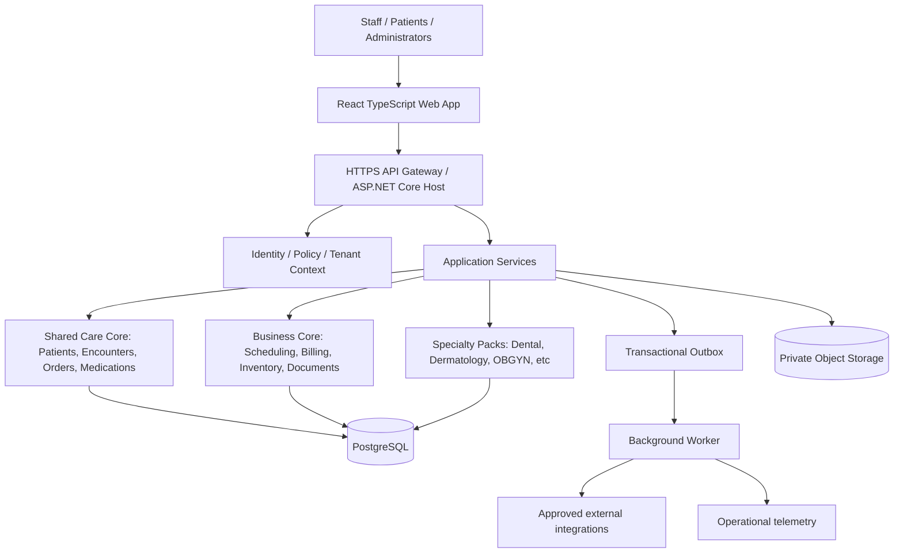

# 01 — System Architecture

## Goals and constraints

- One commercial product with tenant/clinic/branch specialization; not bespoke forks for every dentist or clinic.
- Low infrastructure burden for small clinics, while supporting chains and health networks.
- Reliable daily use in locations with intermittent internet and power.
- Integrity and traceability of clinical records take priority over feature velocity.
- Integration-ready; not necessarily integrated with every external system on day one.
- Every module has an explicit owner, schema, public contracts, migrations and tests.

## Logical architecture

Components inside the host communicate through explicit application interfaces or internal messages. Direct cross-module access to another module's private tables is prohibited. Keep the transactional outbox in the same PostgreSQL transaction as the business state change.

## Deployment profiles

### A. Cloud-managed SaaS

For clinics with stable connectivity: web app + API service + managed PostgreSQL + private object store + asynchronous worker. Isolate each tenant logically. Higher-risk or larger customers may require dedicated databases. Keep a region and data-residency review before choosing infrastructure.

### B. Clinic-local deployment

For facilities that must run through a WAN outage: deploy a licensed, patched instance of the ASP.NET Core host, PostgreSQL and document service on a secured local clinic server connected through LAN; optional controlled synchronization to central services where authorized. The clinic can continue scheduling, clinical note taking, receipts and printing during internet loss. Local operation still requires reliable power, endpoint hardening and tested backups.

### C. Hybrid chain

Clinic-local edge nodes exchange authorized changes with a central service. Do not naïvely replicate SQL tables bidirectionally. Use a domain-aware sync protocol, durable event IDs, cursors, idempotency, explicit conflicts and patient-matching workflows. Pharmacy dispenses, payments, signed notes and orders must never silently merge using last-write-wins.

## Key boundaries

- **Identity and Tenant:** users, professionals, facilities, affiliations, role/attribute policy, access session.
- **Patient Registry:** demographics, identifiers, guardians, contact and matching.
- **Clinical Record:** encounters, notes, history, allergies, problem list, observations, signatures.
- **Orders and Medicines:** lab orders, imaging orders, prescriptions, dispense workflows.
- **Scheduling and Front Desk:** slot capacity, bookings, queue and triage handoff.
- **Finance:** price books, invoices, payment receipts, refund controls, claims.
- **Supply:** catalog, lot/batch/expiry, purchasing, dispense/consume inventory events.
- **Documents:** templates, generated versions, signatures, print/export audit.
- **Specialties:** examination models and specialist UI connected to shared encounter IDs.
- **Reporting:** authorized, aggregated operational read models; not direct free-form access to all protected tables.
- **Integrations:** FHIR translation, lab interfaces, payment providers, approved message channels.

## Runtime patterns

- Synchronous REST for ordinary reads and simple commands; use typed DTOs and API versioning.
- Postgres ACID transactions for scheduling consistency, ledger postings, prescriptions and signed encounter transitions.
- Outbox + worker for SMS, reminders, report exports, synchronization and integration dispatch; retry with backoff and dead-letter handling.
- Redis only for cache/rate limiting/ephemeral locks where correctness does not rely solely on cache state.
- Object storage for clinical images, PDFs and scans; content hash, immutable version reference, authenticated access, anti-malware validation, storage encryption.
- All events include event_id, tenant_id, actor_id, occurred_at_utc, correlation_id, schema_version; avoid PHI in event payloads when identifiers suffice.

## Core transaction example: sign clinical note

1. Validate clinician affiliation, license/privilege where relevant, encounter ownership or authorized coverage and tenant.
2. Validate required fields and acknowledgements; reject if clinical critical checks are unresolved.
3. Compare encounter/note `row_version` to prevent lost updates.
4. Write an immutable signed note version and note hash; link signer identity and timestamp.
5. Write audit and outbox messages in the same transaction or another reliability-preserving mechanism.
6. Background worker generates a protected PDF rendering of the exact signed version.
7. Subsequent changes create addenda or corrections that reference the prior version.

## Nonfunctional architecture targets, to validate with load testing

- Typical patient search p95 < 500 ms at agreed pilot concurrency.
- Typical encounter open p95 < 1 s from a warmed clinic LAN.
- Availability objective to be chosen separately for cloud vs local operation; no unsupported guarantee.
- RPO <= 15 minutes and RTO <= 4 hours proposed for pilot central infrastructure, contingent on backup and restore test results. Tighter targets for larger clinics require additional engineering and cost.
- Responsive UI for 1366x768 reception monitors and smaller physician tablets.

## What NOT to build initially

A fully distributed microservice mesh, a general-purpose low-code programming platform, autonomous medical diagnosis, cryptocurrency-based records, cross-clinic patient data pooling without lawful basis, or a shared database where any module can rewrite another module's clinical data.
