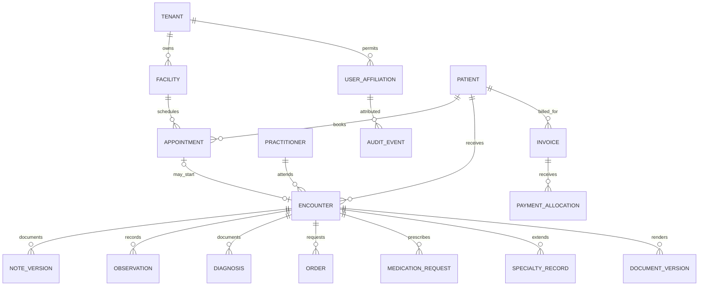

# 03 — Data, Integrity, Interoperability and API Design

## Data architecture

PostgreSQL is the system of record. Separate modules by database schemas or logical boundaries (`identity`, `patients`, `clinical`, `scheduling`, `billing`, `inventory`, `documents`, `dental`, `dermatology`, `obgyn`, `audit`, `integration`). Use migrations for every schema change. Keep database relations explicit and indexed; use JSONB only for bounded, versioned extensions, not as an unvalidated replacement for all clinical records.

### Canonical entities and relationships



### Minimum entity groups

- Tenant, facility, department, room, service catalog, time zone, settings version.
- Person/patient, identifiers, local patient number, name variants, contact points, guardians, consent decisions, duplicate review.
- Practitioner, credential, employment/affiliation, role assignments and facility privileges.
- Appointment, schedule block, waitlist, queue ticket, encounter and encounter participant.
- AllergyIntolerance, Problem/Condition, Observation, NoteDraft, NoteVersion, Procedure, MedicationRequest, ServiceRequest and result acknowledgement.
- DentalToothFinding, DentalTreatmentStage; DermatologyLesion, DermatologyPhoto; ObstetricVisit, PregnancyEpisode and related specialty typed entities.
- Invoice, InvoiceLine, Receipt, Payment, Refund, Claim, CashDrawer, account postings if needed.
- StockItem, Lot, Location, Movement, supplier, purchase order, receipt and dispense.
- DocumentTemplateVersion, DocumentVersion, print event, delivery event, attestation and attachment.
- AuditEvent, SecurityEvent, OutboxMessage, SyncCheckpoint, SyncConflict and ImportBatch.

Every protected clinical table should carry tenant/facility scoping as appropriate, stable UUID keys, actor and timestamps. Implement optimistic concurrency token for mutable aggregate roots. Maintain unique indices for idempotency keys, external import identifiers and business numbers within defined facility/tenant scopes.

## Tenant isolation example (illustrative)

```sql
ALTER TABLE clinical.encounters ENABLE ROW LEVEL SECURITY;
ALTER TABLE clinical.encounters FORCE ROW LEVEL SECURITY;
CREATE POLICY encounter_tenant_isolation
ON clinical.encounters
USING (tenant_id = current_setting('app.tenant_id', true)::uuid)
WITH CHECK (tenant_id = current_setting('app.tenant_id', true)::uuid);
```

The API must set tenant context per transaction using a validated server-side tenant affiliation, never a trusted client-supplied header. The application DB login must not own/bypass protected tables. RLS is **defense in depth**, not a replacement for clinical role and encounter access policy. Test that tenant context cannot bleed between connection-pool requests, that missing context fails closed and that privileged/admin/reporting paths are separately authorized. Refer to PostgreSQL documentation: https://www.postgresql.org/docs/current/ddl-rowsecurity.html

## Financial integrity

- Money stored with decimal/numeric precision and currency, never floats.
- Posted invoices and receipts are immutable records with reversal/credit note flows; no silent overwrite.
- Use durable idempotency keys on payment callbacks, dispense actions and stock movements.
- Maintain a clear event trail for refund/adjustment approvals and cash drawer reconciliation.
- Accounting integration is a separate boundary; do not let clinical features write journal entries directly.

## Clinical record integrity

- Note drafts editable with concurrency control and autosave; final notes signed and versioned.
- Explicit amendment chain, reason for change, attributed author and signer, UTC timestamp, content hash.
- Source device/time and clinical reference context for imported observations.
- Keep original uploaded image or external result file when appropriate; derivatives never erase source.
- Structured coded value + human-entered display text where needed, with coding system/version metadata.

## API conventions

API root `/api/v1`; OpenAPI description generated as part of build. JSON for CRUD and commands; return RFC 7807-style problem details for failures. Idempotency keys on critical POST commands and ETags/version tokens for updates. Never expose internal EF entities through public APIs.

Examples:

```http
GET    /api/v1/patients?query=...
POST   /api/v1/patients
GET    /api/v1/patients/{patientId}/timeline
POST   /api/v1/appointments
POST   /api/v1/encounters
POST   /api/v1/encounters/{id}/notes
POST   /api/v1/encounters/{id}/sign
POST   /api/v1/encounters/{id}/amendments
POST   /api/v1/encounters/{id}/medications
GET    /api/v1/documents/{id}/preview
POST   /api/v1/documents/{id}/finalize
GET    /api/v1/documents/{id}/download
POST   /api/v1/invoices/{id}/payments
GET    /api/v1/audit/events?resourceId=...
```

Accessing the timeline or document requires server-side patient, encounter and facility authorization. Search endpoints must not leak the existence of patient records across tenants or unauthorized departments.

## Interoperability

Build an adapter that maps canonical business entities to FHIR resources: Patient, Practitioner, Organization, Appointment, Encounter, Observation, Condition, AllergyIntolerance, Procedure, ServiceRequest, MedicationRequest, DiagnosticReport, DocumentReference, Consent, Provenance and AuditEvent. Start with a selected **FHIR R4** profile when required by integration partners; implement R5 only if partner requirements justify it. FHIR is a published exchange standard, not an internal domain model requirement: https://hl7.org/fhir/R4/

Codes: WHO ICD-11 (with versioning and national-reporting mapping where required); LOINC for tests/observations; SNOMED CT only under appropriate license. Images: DICOM interoperability for compatible imaging devices/PACS, not arbitrary image formats disguised as DICOM. National interoperability: evaluate interfaces to Ethiopia's NDHx, MFR and approved reporting workflows rather than assuming a direct live connection exists.

## Data portability and deletion

Patient record exports must have permissions, justified scope, manifest of included resources, encrypted delivery and audit trail. CSV exports for administrative records; machine-readable medical data where lawful and technically appropriate. Define retention, legal hold, de-identification, correction and permissible disposal policies with legal and clinical governance. Never assume a patient deletion request permits erasing a legally required medical record.
