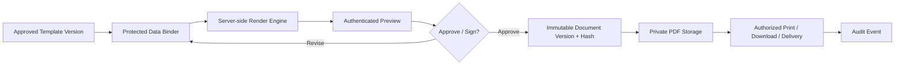

# 05 — Clinician Experience, Documents, Preview and Printing

## Visual design principles

Quiet, uncluttered, intentional interface: warm white or off-white working surface, charcoal readable text, restrained forest-green accent, accessible contrast, generous spacing and strong data hierarchy. No uncontrolled gradients, animation-heavy charts or dense form walls. Every page should foreground the next clinical action. Support English, Amharic and Tigrinya with tested fonts and bidirectional/localization practices where required; Gregorian and Ethiopian calendar input/display may coexist but all backend dates need canonical storage and unambiguous conversions.

## Global interface shell

Left sidebar: Home, Today, Patients, Appointments, Consultation, Orders, Pharmacy, Billing, Reports, Administration (visibility by role). Header: facility context, currently authenticated staff identity, global scoped search, urgent tasks, notifications, help. Avoid patient-name inclusion in browser push notifications or casual external messaging.

### Doctor encounter view

- Top strip: patient ID + identifying details, allergies, critical warnings, age and encounter status.
- Left: clinical timeline, chronic problems, medications, prior visits and recent results.
- Center: today’s reason for visit, clinical forms, visual examination tool, orders, note editor.
- Right: actionable contextual checks, existing results, procedures, follow-up and draft status.
- Sticky clinical actions: Save draft, Order, Preview, Sign/Finalize, Refer; disabled actions explain requirements.
- Autosave with explicit status and version conflict handling; do not silently overwrite another clinician’s changes.

### Reception view

Today’s schedule with doctor/room filter, check-in queue, patient quick search, duplicate warning, accessible keyboard shortcuts and one-click follow-up booking. Keep demographic display minimal in a public-facing reception environment.

### Management view

At-a-glance queue, average wait, clinician utilization, completed visits, cash reconciliation and stock alerts. Admin dashboards show aggregate/authorized metrics; avoid a managerial default that exposes private consultation notes.

## Document pipeline

Templates: letterhead, outpatient card, clinical visit summary, dental treatment plan, medication prescription, lab request/result, referral letter, medical certificate, consent form, tax-compliant invoice/receipt, account statement and discharge/follow-up instruction. Each template has a published immutable version and a clear owner.

## Print/document controls

- A4 and A5 print profiles, page breaks, margins, running headers/footers, optional QR verification and signature blocks.
- Clinic logo, valid accreditation/credential fields, contacts, configurable language, stamp/signature display rules; never embed a clinician’s signing secret in the template.
- Preview generated by the **same renderer** as final output, from the same document snapshot and template revision.
- Preview watermark for drafts; original signed final never inherits draft watermark.
- Rendering uses trusted template definitions and escaped patient text; untrusted HTML is prohibited.
- Private preview object access is authenticated, scoped and short-lived; avoid public predictable PDF URLs.
- Print/download events audited; printed documents identified by version, issuing institution and timestamp.
- QR codes should contain an opaque verification reference or approved verification URL, **never medical details**.
- Electronic signing/attestation must distinguish clinician sign-off from any jurisdictional qualified digital signature requirements.
- Provide a printer test page, printer selection guidance and failure recovery; do not consider browser print dialog a guarantee that paper printed.

## Reports and exports

All relevant reports can be previewed before PDF, XLSX or CSV export. Exports are generated asynchronously for large datasets, protected by authorization and expiration. Include filter summary, clinic, generation date, timezone, row count, requesting user, document version and sensitivity classification. Administrative exports must not automatically include clinical notes. A report creator should be unable to bypass object-level authorization through a broad SQL filter.

## Accessibility and performance

WCAG 2.2 AA as a design/testing target; all clinical diagrams have alternative tabular/nonvisual data entry. Full keyboard support, visible focus, 200% zoom, no use of color alone for clinical alerts, accessible form validation, robust timeouts and unsaved-change warnings. Load screens incrementally; use virtualized tables for large results; index scoped patient search; keep encounter action buttons responsive even on slow LAN.
