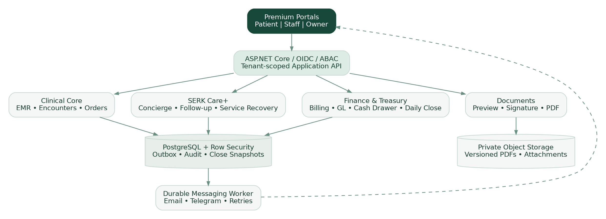
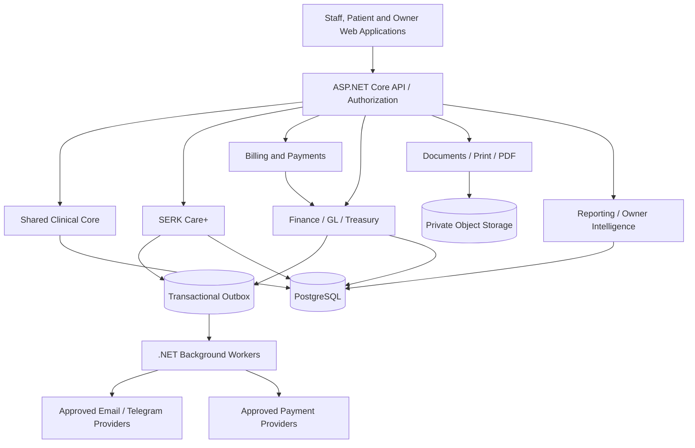

# SERK CLINIC OS

## Premium Patient Experience, Financial Integrity & Owner Intelligence

**Developer Software Requirements Specification + Architecture & Implementation Addendum**  
**Document ID:** SERK-CLINIC-SRS-CARE-FIN-002  
**Version:** 2.0 (engineering design baseline)  
**Date:** 10 November 2026  
**Prepared for:** SERK Technology Group — Product, Engineering, Clinical Safety, Finance and Operations Teams  
**Classification:** Confidential — internal development and authorized stakeholders  
**Status:** Proposed specification; not implemented, audited or clinically certified

> **Product promise:** A patient should feel looked after at every interaction; a clinician should have complete confidence in the record; the owner should be able to trace every birr from the originating service to the final ledger and approved daily close.

---

# 1. Executive mandate

SERK Clinic OS shall become a multi-specialty clinic operating system that combines high-quality clinical workflows, premium customer experience, robust financial controls and transparent business intelligence. This specification extends the existing SERK Clinic OS architecture kit and Claude Code engineering kit. It is **not** a replacement for their clinical safety requirements or an instruction to discard working code.

The product shall run as a configurable C#/.NET 10 modular monolith with PostgreSQL as its system of record and a responsive React/TypeScript interface (or a formally approved single frontend alternative). Every specialty shares patients, encounters, finances, identity, documents, audit, notifications and reporting, while its own clinical extensions remain independently maintainable.

## 1.1 Outcomes to optimize

1. **Patient trust:** rapid booking, clear communication, accessible experiences, informed consent, continuity of care and respectful complaint handling.
2. **Staff confidence:** fast workflows, few clicks, safe defaults, accurate tasks, clear ownership and no contradictory screens.
3. **Financial truth:** no unexplained money, no silent deletion, double-entry posting, immutable source evidence, complete cash/digital reconciliation and auditable adjustments.
4. **Owner visibility:** real-time authorized dashboards, exception alerts, automatically generated daily-close reports and drill-down evidence.
5. **Maintenance:** one product, tenant-aware configuration, versioned contracts, testable domain rules, safe upgrades and documented operation.
6. **Resilience:** predictable behavior during network outages, retries, delayed settlements, printer faults and failed integrations.

## 1.2 Non-negotiable system principles

- Clinical priority is determined by medical urgency, not subscription tier, money or VIP status.
- Administrators and owners see financial and operational metrics by default, **not** unrestricted confidential clinical notes.
- Posted financial records are immutable business evidence. Corrections use linked reversals, credit notes, refund documents or adjustments, never hidden editing.
- All amounts use `numeric/decimal`, a specified currency and explicit rounding rules; floats are prohibited for money.
- Care follow-ups require approved clinical rules and accountable human escalation; AI never independently diagnoses or signs clinical decisions.
- Telegram/email channels transmit only approved minimal financial summaries and secure report links by default, **not** identifiable patient details, treatment information or unprotected patient reports.
- A report marked “complete, verified” must be computed from committed source data at a known cutoff, reconciled and approved under a recorded policy.
- No guessed tax rates, live payment integrations, regulatory approvals, or clinical accuracy claims. National and facility-specific obligations must be validated with qualified advisors.
- Features should degrade safely when external channels, payment providers, AI or cloud infrastructure are unavailable.

## 1.3 Decisions needing explicit business signoff

| ID | Decision | Recommended initial default | Approver |
|---|---|---|---|
| DEC-01 | Single vs multi-tenant deployment | Configurable tenant/branch with strong isolation | Product + Security |
| DEC-02 | Accounting basis | Accrual ledger with cash movement reporting | Finance lead |
| DEC-03 | Financial close cut-off | Facility-local configured business day | Finance lead + Owner |
| DEC-04 | Owner delivery channels | Portal + optional verified email/Telegram digest | Owner + Security |
| DEC-05 | Clinical aftercare | Approved protocols, opt-in where needed | Clinical governance |
| DEC-06 | Payment integrations | Adapters with reconciliation, initially sandbox | Finance + Security |
| DEC-07 | Tax/receipt rules | Versioned config, jurisdiction reviewed | Qualified accountant/tax adviser |
| DEC-08 | Data hosting/residency | Legal review before provider selection | Legal + Security |

# 2. Product operating model and roles

## 2.1 Personas

**Patient/guardian:** books visits, shares preferences, sees approved documents, receives aftercare, contacts staff and reports issues. **Receptionist/concierge:** coordinates schedules and waiting experience with minimum necessary demographics. **Clinician/nurse:** manages clinical decisions, signed notes and approved follow-ups. **Cashier:** creates invoices within policy, collects payments, issues receipts and closes own drawer. **Finance supervisor:** reconciles, approves corrections and closes a business day. **Owner/board delegate:** receives financial intelligence and exceptions, approves explicitly delegated transactions. **Pharmacist/inventory manager:** dispenses approved orders, tracks lots and stock. **Clinic manager:** monitors service quality and capacity without default medical-record access. **SERK platform support:** diagnoses infrastructure through privacy-safe telemetry, with exceptional scoped access separately approved, time-limited and audited.

## 2.2 Permission model

Authorization shall use role + tenant + facility + assignment + transaction amount + resource sensitivity + task state, with deny-by-default. Sensitive actions (refund, price override, journal adjustment, write-off, close reopen, owner-recipient change, clinical break-glass access) require step-up authentication, documented reason and appropriate separation of duties. The system shall prevent a creator from self-approving high-risk financial operations when a separation-of-duties policy applies.

## 2.3 Domain boundaries

| Domain | Owns | Must not own |
|---|---|---|
| Identity & Organization | Users, affiliations, clinics, roles | Medical diagnoses, account postings |
| Patient Care | Patient identity, encounters, signed notes | Owner's bank data, ledger entries |
| SERK Care+ | Patient journey, follow-ups, service cases | Diagnosis or autonomous treatment changes |
| Sales & Billing | Service catalog, estimates, invoice lifecycle | Posted GL journal mutation |
| Finance & Treasury | Cashier sessions, payments, settlements, GL, reports, closes | Clinical medical record authorship |
| Pharmacy & Inventory | Lots, dispense, stock movements, purchasing | Undocumented cash settlements |
| Documents | Templates, versions, PDFs, delivery evidence | Independent clinical/finance authorization |
| Notifications | Channel preferences, durable dispatch and receipts | Secret-free message content generation policies |
| Analytics | Authorized projections and KPI snapshots | Bypassing source-domain access rules |

# 3. Whole-system luxury experience standard

Luxury shall mean **reliable, calm, personalized, equitable and discreet service**, not excessive visual decoration. Every screen uses the same design tokens and interaction rules.

## 3.1 Design system: SERK Calm Precision

- **Palette:** warm ivory/white working canvas, near-black body text, restrained forest green accents, and semantic colors for success/warning/danger. Critical clinical risks must use explicit text/icons, not color alone.
- **Type:** readable multilingual font stack tested in English, Amharic and Tigrinya; fluid sizing and sufficient contrast. Never trade readability for thin decorative typography.
- **Navigation:** role-aware left rail on desktop, compact adaptive navigation on mobile; breadcrumbs and keyboard shortcuts where safe.
- **Density:** optional comfortable/compact table density; consistent 8-point spacing; progressive disclosure; rich tooltips and contextual help.
- **Components:** intelligent global search, command palette, contextual action bar, appointment timeline, smart filters, table views, calendar views, document viewer and quick actions.
- **Interaction:** optimistic UI only for reversible noncritical actions; server-confirmed state for financial postings and clinical signatures. Skeleton loading and actionable errors; no fabricated success messages.
- **Accessibility:** target WCAG 2.2 AA, keyboard navigation, reduced motion, 200% zoom, screen reader labels and clear form errors.
- **Localization:** locale-format UI, canonical timestamps, Ethiopian/Gregorian calendars with unambiguous conversion, configurable facility timezone, English/Amharic/Tigrinya professional translations.
- **Customization:** tenant branding, logo, service terminology, dashboard cards, approved templates, accessible themes and configurable workflow options—not uncontrolled patient-record schema editing.

## 3.2 Signature user experiences

| User | Required premium experience | Measurable acceptance |
|---|---|---|
| Patient | Book/reschedule, receive clear visit prep, access approved records | No unnecessary account creation for low-risk booking; privacy controls |
| Reception | One workspace for search, check-in, queue, payment status | Common booking flow possible without navigation across many screens |
| Clinician | Patient timeline, observations, orders, notes and follow-up panel | Signed note cannot be modified without addendum |
| Cashier | Charge preview, payment options, transparent receipt and end-shift closure | Each tender traceable to invoice and drawer/settlement |
| Manager | Queue bottlenecks, complaints, no-shows, staffing and stock | Drilldowns only to authorized data |
| Owner | Multi-branch day-close, cash variance, collections, profitability and exceptions | Every figure carries source lineage and close version |

# 4. SERK Care+: premium patient lifecycle

## 4.1 Pre-visit: effortless access

**CARE-001 Personalized scheduling:** book by doctor, location, specialty, service, language and accessibility need; show valid availability, duration and preparation requirements. Race-proof booking with unique slot allocation and conflict tests.

**CARE-002 Private preference profile:** preferred language, consented message channel, visit type, accessibility accommodation, companion needs and preferred appointment windows; highly sensitive notes segregated from hospitality preferences.

**CARE-003 Transparent preparation:** send configurable directions, parking, arrival window, preparation, documents to bring, deposits or cost estimates. Content authored/reviewed by facility staff.

**CARE-004 Safe reminders:** preferences, opt-out, quiet hours, retries, consent. Generic message content by default. Missed or failed messages appear in staff work queues.

**CARE-005 Digital onboarding:** secure pre-registration, patient identity verification, consent versioning, accessible forms and document capture; explicit duplicate detection and authorization.

**CARE-006 Journey clarity:** patient can see a simple sequence: appointment scheduled → preparation → arrival → consultation → payment → care plan → follow-up.

## 4.2 Arrival and reception

**CARE-007 Express check-in:** QR/short code for appointment reference; staff can verify identity without exposing names on public displays. Paper/assisted alternatives supported.

**CARE-008 Waiting transparency:** realistic queue estimate with confidence range, timely updates and no promises unsupported by actual clinician capacity. Medical triage can reorder queue.

**CARE-009 Hospitality assistance:** accessibility and language support; visitor routing, escort tasks, relevant room navigation and accommodations.

**CARE-010 Reception recovery:** delayed appointments automatically create assigned communication tasks, not silent status changes.

**CARE-011 Concierge handoff:** a complex case receives a named coordinator for the visit journey, with audit and workload limits.

## 4.3 Consultation and discharge

**CARE-012 Clinician-first workspace:** allergies, identity, history, prior care, orders and progress in a concise protected timeline. Patient-facing view hides technical jargon when useful.

**CARE-013 Visual care plans:** show upcoming visits, preparation, care tasks and transparent estimated costs, always clearly marked estimate vs posted invoice.

**CARE-014 Secure media:** dental tooth charts, dermatology photographs and other specialty images use the existing clinical authorization controls. Marketing or teaching reuse requires separate explicit consent.

**CARE-015 Discharge pack:** deliver clinician-approved instructions, medication list, next steps, warning signs and contact options with preview/PDF, signature/versioning and secure delivery.

**CARE-016 Digital document vault:** prescriptions, referrals, certificates, receipts, approved results and care plans with scoped access, downloads and a full audit trail.

**CARE-017 Patient question channel:** route administrative messages to service staff and medical questions to trained clinical queues with explicit response hours and emergency disclaimers.

## 4.4 Aftercare and follow-up orchestration

**CARE-018 Protocol library:** specialty-approved protocols with version, eligibility, message templates, safety-net instructions, escalation thresholds, clinician owner and expiry.

**CARE-019 Due-date engine:** creates exact follow-up tasks tied to encounter, consent, clinician-approved care plan, responsible team, timezone and due time. Never generates automatic clinical advice outside approved content.

**CARE-020 Symptom questionnaires:** ask only clinically appropriate questions; responses are time-stamped and can create high-priority clinician review tasks.

**CARE-021 Escalation:** red flags trigger a queue item with acknowledgment deadline and escalation chain; critical messages never depend solely on a messaging bot being read.

**CARE-022 No-response policies:** retry within consent, record failed attempts, create a human outreach task where clinically warranted, and never close as successful without valid closure evidence.

**CARE-023 Result follow-up:** order → result → clinician acknowledgment → patient notification → required action completion; unreconciled items appear in safety dashboards.

**CARE-024 Patient-initiated follow-up:** allow eligible patients to request check-in, with clinician-approved eligibility and safety rules.

**CARE-025 Family care circle:** authorized guardian/proxy scope, verified relationships, explicit revocation, age-of-majority transition, confidentiality limits and separate identity/access audits.

## 4.5 Service recovery and satisfaction

**CARE-026 Complaint intake:** in person, portal, phone log or authorized messaging. Categorize service dissatisfaction separately from clinical safety incidents.

**CARE-027 Accountable resolution:** ticket owner, acknowledgement SLA, investigation, response, adjustment approval if any, resolution evidence and closure confirmation.

**CARE-028 Patient feedback:** short, opt-in post-visit questions, language choice, contextual surveys, neutral wording and no pressure for positive reviews.

**CARE-029 Service-recovery safeguards:** financial goodwill/credits must follow billing approval; clinical adverse events follow a separate incident process with restricted access.

**CARE-030 Continuous improvement:** aggregate trends by clinician service area, time window, facility and complaint category with privacy thresholds; avoid unfair individual rankings without adequate context.

## 4.6 Premium innovation catalog (optional, gated)

- Video-based administrative orientation, teleconsultation only where approved and legally suitable.
- Personal care navigator for multi-visit dental plans, antenatal journeys, chronic disease follow-up and complex referrals.
- Digital family appointment planner with strict proxy access.
- In-clinic tablet kiosk with privacy screen, accessibility mode and safe session termination.
- Optional multilingual knowledge base, clinician-reviewed content and appointment self-service.
- Patient-reported outcome measures (PROMs) chosen and validated for each specialty.
- Preventive care reminders based on documented clinician-approved schedules, without deceptive marketing.
- Smart no-show propensity indicators used to offer assistance, not penalize vulnerable patients.
- Personal financial estimates and phased treatment proposals; no undisclosed charges.
- Home-care instructions and approved rehabilitation exercise tracking where clinically appropriate.

# 5. Specialty experience packs

Every specialty is a typed extension of shared encounters and care plans. A new specialty must supply a tested manifest, forms, clinical terminology, document templates, authorization, aftercare protocols and finance service/procedure mappings.

| Specialty | Distinct workflow | Premium experience | Follow-up safety |
|---|---|---|---|
| Dental | Odontogram, periodontal chart, staged treatment, materials/lot usage | Visual tooth plan, stages, cost timeline, photo progression | Approved postoperative check-in; suspected complication escalated |
| Dermatology | Body map, lesion history, image series, procedure record | Controlled before/after visual comparison, treatment calendar | Clinician review of concerning skin changes, photo privacy |
| Gynecology/OB | Pregnancy episode, prenatal, reproductive history, ultrasound | Private messaging, visit plan, chosen companion and dignity controls | Sensitive notification restrictions; high-risk routing |
| Pediatrics | Guardian records, growth charts, vaccines | Family portal, age-appropriate instructions | Guardian verification, safety and age-based controls |
| Ophthalmology | Visual acuity, pressures, imaging, prescriptions | Clear progress charts and procedure instructions | Urgent vision symptoms escalated |
| ENT | Audiometry, endoscopy, treatment plan | Hearing-support accessibility options | Clinician-approved postoperative/risk follow-up |
| Orthopedics | Injury episodes, imaging, procedures, rehabilitation | Recovery milestone tracker | Complication reporting, therapy plan adherence |
| Cardiology | Investigations, symptoms, monitoring | Coherent long-term care timeline | Human-reviewed high-risk exceptions |
| General medicine | Chronic care, medication review, referrals | Personal condition and follow-up plan | Closed-loop referrals and results |
| Aesthetic services | Consents, photo series, product/lot tracking | Transparent packages and expected recovery timelines | No misleading guarantees; adverse-event escalation |

---
# 6. SERK Finance: accounting, treasury, traceability and control

## 6.1 Finance mission and scope

The Finance and Treasury subsystem shall present a **single source of financial truth** for each legal entity, facility, department, point of sale and business day. Operational transactions shall generate accounting effects through controlled posting commands and explicit mapping rules, never direct free-form journal writes from clinical modules.

Support estimates, invoices, receipts, advance deposits, treatment packages, receivables, insurance claims, credit notes, refunds, cash drawers, card/mobile money/bank receipts, provider settlements, purchasing, expense approvals, vendor payables, inventory valuation, staff reimbursements, journal adjustments, general ledger, reconciliation, close, and owner reporting. Payroll and full treasury forecasting are optional phase-two integrations unless needed at pilot.

### Finance feature requirements

| ID | Requirement | Mandatory control |
|---|---|---|
| FIN-001 | Configurable chart of accounts (COA) per entity | Versioned code mappings, posting validation |
| FIN-002 | True double-entry GL | Sum(debits)=Sum(credits), same currency/base-currency rules |
| FIN-003 | Source transaction tracing | Source document → subledger → journal → cash/settlement → close |
| FIN-004 | Sequential business documents | Facility/legal-entity-scoped, controlled gaps/voids |
| FIN-005 | Service and price catalog | Price/version/effective date and approved overrides |
| FIN-006 | Draft/issued/paid invoice states | No direct destructive edit of posted transactions |
| FIN-007 | Mixed tender collections | Every tender captured distinctly and allocated |
| FIN-008 | Mobile-money/bank reconciliation | Provider reference, settlement status and difference queue |
| FIN-009 | Refund/void/credit note workflow | Reason, maker-checker and original transaction link |
| FIN-010 | Cash drawer and cashier shift | Assigned opener/closer, counts and variance |
| FIN-011 | Business-day closure | Preflight checks, supervisor approval and locked snapshot |
| FIN-012 | Period closing | Month-end journal cut-off, controlled re-open and audit |
| FIN-013 | Owner close report | Verified totals, status, exceptions, owner delivery receipts |
| FIN-014 | Tax and statutory configuration | Verified jurisdictional rules, no hardcoded guessed rates |
| FIN-015 | Expense and procurement trace | Request → approval → invoice → payment → journal |
| FIN-016 | Inventory-to-finance reconciliation | Goods receipt/issue/dispense valuation tied to postings |
| FIN-017 | Insurance/credit ledger | Claims, denials, payments, adjustments and aging |
| FIN-018 | Fraud/anomaly watchlist | Escalations for overrides, reversals and abnormal activity |
| FIN-019 | Forecast and performance dashboards | Clearly distinguish actual, forecast and targets |
| FIN-020 | Permissioned export and evidence pack | Authenticated PDF/CSV/XLSX and version provenance |

## 6.2 Canonical ledger architecture

**Subledgers:** patient accounts receivable, payer/insurer AR, cash, bank and provider clearing, accounts payable, deposits/deferred revenue, inventory, fixed assets if added, and payroll if integrated. The general ledger contains balanced, immutable journal transactions generated from approved source states; subledgers reconcile with respective GL control accounts.

**Recommended posting model:**

- `JournalEntry`: `entry_id`, tenant_id, legal_entity_id, facility_id, business_day_id, source_type, source_id, event_id, posting_date, occurred_at_utc, currency, fx_rate_ref, status, approved_by, created_by, posted_at_utc, reversal_of_entry_id, narrative, version.
- `JournalLine`: line_id, entry_id, account_id, cost_center_id, department_id, debit_amount, credit_amount, base_debit_amount, base_credit_amount, currency, service_id optional, reference_id optional.
- `SourceLink`: source document URI/reference, source event hash, invoice/payment/cash drawer/settlement references, accounting rule version, origin role and endpoint.
- `PostingRuleVersion`: event type, account mappings, effective date, branch/legal entity applicability, finance approval and regression fixtures.
- `AccountingPeriod`: state, start/end local business dates, lock and reopen approvals.

**Integrity rules:** Debit and credit entries must balance at the entry scope; prohibit negative debit/credit values, both debit and credit on same line when unnecessary, orphan accounts, obsolete effective dates, cross-tenant source references, duplicate posting from one event, and posting to locked periods without an authorized subsequent-period adjustment. Amounts and quantities must use declared units and precision. If multi-currency is enabled, separately prove original-currency balance and base-currency valuation, with FX gain/loss treatment subject to policy.

### Illustrative mapping table — configure, do not hardcode

| Business event | Debit | Credit | Condition |
|---|---|---|---|
| Issued bill for rendered taxable service | Patient AR | Service revenue + tax payable | Only under approved revenue/tax policies |
| Cash settlement of issued invoice | Cash-on-hand | Patient AR | Posted tender confirmed |
| Mobile payment collected but unsettled | Provider clearing | Patient AR | Provider payment independently verified |
| Provider settlement to bank | Bank (net) + provider fees | Provider clearing (gross) | Verified statement reference |
| Approved refund of previously collected payment | Appropriate refund/AR account | Cash/bank or refund payable | Based on original transaction and accounting review |
| Advance for future care | Cash/bank/clearing | Patient deposit liability | Until appropriate service recognition |
| Inventory purchase invoiced | Inventory + recoverable tax, if applicable | Accounts payable | Valid invoice and receipt/valuation controls |
| Inventory issue to clinical use | Cost of sales or consumption expense | Inventory | Lot/quantity valuation and approved issue |

*Accounting entries above are examples, not jurisdiction-specific financial advice. Refund treatment and revenue recognition must be verified by a qualified accountant.*

## 6.3 'Trace every birr': end-to-end evidence chain


A finance user should be able to click any number in a daily report and open an authorized trace view linking all source evidence and postings. For instance:

`Appointment → encounter completed → priced service → invoice line → issued invoice → receipt → tender collection → bank/telebirr clearing → provider settlement → balanced journal → reconciliation → cashier close → branch daily close → owner digest → report archive`.

**Every step shall reveal** an ID, actor, timestamp, status, amount, currency, relationship, policy version, permitted original attachment/receipt, reversal if any and audit correlation ID. Finance roles can see the service code/charge context needed for reconciliation but cannot see sensitive clinician notes by default.

### Core financial event envelope

```json
{
  "eventId": "<uuid>",
  "eventType": "PaymentVerified.v1",
  "tenantId": "<uuid>",
  "facilityId": "<uuid>",
  "sourceId": "<uuid>",
  "correlationId": "<uuid>",
  "businessDayId": "<uuid>",
  "occurredAtUtc": "2026-11-10T13:30:00Z",
  "recordedAtUtc": "2026-11-10T13:30:02Z",
  "actorId": "<uuid>",
  "amount": "1500.00",
  "currency": "ETB",
  "idempotencyKey": "provider:event:unique-ref",
  "schemaVersion": 1
}
```

**Event discipline:** the producer commits business state + audit + transactional outbox in the same database transaction. The worker retries with idempotency; posting services accept the event only once. Use authoritative provider callbacks/reconciliation, not a browser's payment-success message. Avoid unnecessary patient-identifying fields in events.

## 6.4 Invoice and payment integrity

An invoice has a versioned `Draft → Approved/Issued → PartiallyPaid → Paid/Settled` lifecycle with explicit `CancelledViaCreditNote`, `Adjusted` and `Disputed` paths. Service entries show quantity, unit price, discounts, tax mapping, total, source service/encounter ID, facility and pricebook revision. Overrides require reason/approval when thresholds are crossed. Support deposit schedules and staged dental treatment proposals without falsely recognizing undelivered services.

A payment attempt is distinct from an actually verified payment and separately distinct from provider settlement. Typical states: `Initiated → PendingProvider → ProviderConfirmed → AppliedToInvoice → SettledToBank`, plus `Failed/Expired/Reversed/Chargeback/Disputed` paths. All external provider callbacks require signature validation or an equally robust provider-endorsed authenticity mechanism, replay prevention and unique gateway references. Match settlements by reference, currency, amount, date and provider, with an exception queue for unmatched items.

**Financial invariants:**

- Same provider transaction cannot create multiple payments or journal entries.
- Receipts and invoices keep human-visible serials and stable unique IDs; technical IDs must not depend on date-based numbering.
- A partially allocated payment cannot exceed remaining verifiable funds; overpayments are recorded in appropriate liability/credit balances.
- Refunds link to originals, remain within permissible refundable balances and record actual payout settlement.
- Cash drawers cannot accept unassigned/unapproved tender postings.
- Retrospective edits never bypass close/period locks; a correction posts an attributable adjusting entry in an open period according to finance policy.
- Offline payments require controlled risk limits and must be distinguished from provider-confirmed electronic collections.

## 6.5 Cashier sessions and cash control

Each cashier session is scoped to facility, till/drawer, user and shift. Support opening float, verified cash receipts, cash payouts, safe drops, transfers, reversals, manual-count denominations and supporting evidence.

**Expected cash** = opening float + verified cash receipts + authorized cash-in transfers − verified cash refunds − approved petty cash disbursements − safe drops − authorized cash-out transfers. **Count variance** = physically counted cash − expected cash. Other noncash payments belong to distinct tender and clearing accounts, not expected cash.

Cashier flow:

1. Supervisor assigns drawer, opening float and accountable cashier; cashier acknowledges.
2. Each receipt posts to drawer/session with immutable receipt and till ID.
3. Pre-close shows expected cash **without silently suggesting a physical count**; counting can be blinded if desired.
4. Cashier enters denomination count and provides explanation for variance; controller reviews variance against threshold.
5. Supervisor verifies source completeness and approvals; cashier session is closed with a signed immutable snapshot and cashier acknowledgment.
6. Cashier can no longer post into the closed session. Corrections are linked adjustments with later-period treatment and documented approvals.

Prevent shared till identity without attribution. For physically shared drawers, define a handover workflow with dual acknowledgment and traceable cash transfer events.

# 7. Daily financial closure engine — precise requirements

## 7.1 Business-day boundary and states

A business day is a **configured local operational interval**, not necessarily UTC midnight. Each clinic sets timezone (e.g., `Africa/Addis_Ababa`), cut-off clock, working calendar, shift policy and whether special exceptions may extend the day. Store instants in UTC and preserve immutable calculated business-day assignment using versioned timezone/cutoff rules. Ethiopian date is a display/report format; the canonical posting date and its mapping must remain unambiguous.

**Branch close state machine:** `OPEN → PRE_CLOSE → RECONCILIATION_PENDING → SUBMITTED → APPROVED → LOCKED` or `REOPEN_REQUESTED → CONTROLLED_ADJUSTMENT`. For failed approval: `RETURNED_FOR_CORRECTION`, preserving previous review and discrepancy evidence. Prohibit a `VERIFIED` state if mandatory checks are unresolved or required approvals are absent. An owner digest can be sent earlier with explicit `PROVISIONAL` status; it must not masquerade as the approved final report.

## 7.2 Mandatory close validation gates

| Gate | Control | Blocking behavior |
|---|---|---|
| CLOSE-01 | All assigned cashier sessions closed or documented exceptional handover | Block final lock |
| CLOSE-02 | All posted invoices and payments have valid journals | Block final lock |
| CLOSE-03 | Journal balance and posting integrity verified | Block final lock |
| CLOSE-04 | Cash over/short variances resolved or approved with reason | Block or qualified exception per policy |
| CLOSE-05 | Unmatched mobile/bank settlements separately identified | Allow only defined conditional status, not fully reconciled |
| CLOSE-06 | Credit notes, refunds, discounts and overrides reviewed | Block over-threshold unresolved exceptions |
| CLOSE-07 | Imported transaction jobs all accounted for through cutoff | Flag missing input, block when material |
| CLOSE-08 | Inventory consumption and financial postings reconciled for designated controlled classes | Flag difference; block where policy requires |
| CLOSE-09 | Outstanding advances, packages and patient credit balances correctly classified | Reconcile |
| CLOSE-10 | Tax, invoice numbering, gaps and receipt integrity validated | Block unresolved material errors |
| CLOSE-11 | All required approvals, signatures and close commentary present | Block |
| CLOSE-12 | Snapshot generated and independently re-aggregated from immutable committed data | Block mismatches |

## 7.3 Close summary metrics and definitions

- **Gross charges:** issued invoice line amounts before discount and tax, with precise inclusion rules.
- **Discounts:** approved discounts and promotional allowances with source evidence.
- **Net revenue posted:** recognized service revenue under finance-approved posting rules; not equal to cash collected.
- **Tax liability movements:** tax postings based on configured, reviewed mappings; separately display tax-inclusive vs tax-exclusive totals.
- **Total patient collections:** verified applied payments by tender (cash, bank, card, mobile money, insurance) with clear timing.
- **Unapplied funds/deposits:** money received but not yet applied to earned revenue or patient invoice.
- **Refunds:** approved amount, actually disbursed amount, pending liability and source transactions separately.
- **Cash expected/count/variance:** from till controls, not simply the sum of invoices.
- **Provider settlement:** initiated/confirmed/settled and fees, with unsettled exposure distinct from bank cash.
- **Accounts receivable:** outstanding debt by aging bucket and payer/clinic, net of approved credits.
- **Operating expenses paid:** payment outflows classified by cash impact, without confusing paid expense and accrued expense.
- **Posted journal totals:** balanced debits/credits, GL control accounts and unposted transaction counts.
- **Exception counts and values:** missing provider evidence, unreconciled receipts, refunded items, price overrides, negative stock, missing documents and override approvals.
- **Service metrics:** visits, billable encounters, treatments by specialty, cancellations and utilization without revealing sensitive chart details.

Every KPI definition must be documented in code/test fixtures, include a numerator/denominator where relevant, and display its scope, currency, date/time cutoff and status.

## 7.4 Close workflow and report issuance

1. `CloseDue` scheduled at the facility-local cutoff. System freezes the report population boundary by a durable cutoff watermark and captures transactional completeness metadata.
2. Worker performs pre-close reconciliation and generates **preliminary** exception list. Finance staff resolve permitted discrepancies or append explanations and exception approvals.
3. Supervisor reviews each drawer, payment channel, posted journal, receipt sequence and data completeness dashboard.
4. Supervisor executes `SubmitClose`; engine recomputes checks, prevents stale approvals using version tokens, and records exact source snapshot hash.
5. Independent approver (where policy demands) executes `ApproveClose`; server records role, step-up assurance, reason and policy version.
6. Engine `LockClose` persists a versioned immutable close snapshot, generates PDF/JSON summaries, and creates a durable outbox event for delivery.
7. Owner recipient gets either a concise redacted summary and secure link, or an explicit provisional/failed-close alert. All deliveries are traceable to close version and channel recipient.
8. Any later discovered adjustment creates a new linked supplemental report version and separate owner correction notification. Do not overwrite or silently resend the original close as though nothing changed.

**Complex cases:** power loss during close, delayed provider callback, two supervisors approving simultaneously, cross-midnight shifts, daylight-saving in other countries, reversing a sale after lock, offline branch uploads, cash mismatch, partial refunds, void after issue, network failover and document generation errors all have deterministic recorded paths.

# 8. Owner intelligence and automated Telegram/email digests

## 8.1 Recipient configuration and authority

Owner recipient settings shall be stored per legal entity/facility group with authorized recipients, channel type, verified email address or **verified private Telegram chat ID**, subscription scope, locale, preferred delivery time, digest format, allowed sensitivity, second-factor step-up to change recipients, and alert thresholds. Owners may choose branch-only, entity-wide or consolidated views according to permission. The system shall record who granted the subscription and when. Revoke access immediately on role/ownership change.

**Telegram activation:** a bot cannot assume ownership from a username. Recipient initiates a private bot conversation and performs a short-lived verification challenge in the authenticated clinic owner portal, binding that specific chat ID to the account. Restrict to one-to-one chats by default; reject groups/channels for owner financial summaries unless a separately reviewed corporate policy explicitly permits them. Bot token lives in a secret manager, not code or logs. If webhook reception is used, verify Telegram's supported secret-token mechanism and network controls; do not use arbitrary updates to alter sensitive owner settings.

**Email activation:** verify ownership of recipient address and enable SPF, DKIM and DMARC for the sender domain. Use a dedicated service identity and API credentials stored in managed secrets. Avoid PDFs attached to ordinary email by default; use a secure, short-lived link to a portal requiring MFA for detailed reports.

## 8.2 Safe digest policy

Messages may include business name, date, close status, currency, collected totals, tender breakdown, expected/count/variance, refunds, outstanding settlements, overdue follow-ups as **counts only**, operational visit counts and anomaly alerts. Do **not** include patient names, phone numbers, diagnoses, treatment notes, prescription details, medical documents, raw card data, bank credentials, cashier home addresses or private dispute narratives. Strip URLs of bearer tokens in notifications; a report deep link must require logged-in authorization and MFA as policy dictates. Management may select aggregated specialty totals if they cannot expose sensitive small-group patient information.

## 8.3 Recommended delivery schedules

- On branch `LOCKED`: immediate final close digest.
- At configured owner wake-up time (example 07:00 local): prior business-day consolidated briefing; do not invent the actual owner schedule.
- On missing/late close: exception notice identifying facility and status, without claiming final numbers.
- On high-risk exceptional events (large refund, cash shortage, repeated failed settlements, suspicious approval): thresholded alert with link to secure case.
- Weekly and monthly executive reviews: trends, reconciliations, losses, patient service quality and controlled comparisons.

Do not send repeated notifications for the same close version unless deliberate resend is requested or a retry is needed. Quiet hours do not suppress clinically urgent escalation; finance alerts follow configured urgency.

## 8.4 Delivery reliability state machine

`CREATED → RENDERED → QUEUED → SENT_TO_PROVIDER → PROVIDER_ACCEPTED → DELIVERED_IF_SUPPORTED` or `RETRY_PENDING → DEAD_LETTER/NEEDS_MANUAL_ACTION`. The system must distinguish 'provider accepted' from 'user read' because email and Telegram generally do not provide guaranteed human-read acknowledgments through ordinary sending APIs. Do not claim a message was read.

A send attempt stores `delivery_id`, owner_subscription_id, report_version_id, channel, sanitized payload hash, idempotency key, provider message ID (if returned), attempt count, UTC timestamps, error category, next retry and final status. Retries use bounded exponential backoff and circuit breaking. Operators can replay dead letters with authorization. Failure to send must never roll back a financially approved close; delivery exceptions remain visible until handled.

## 8.5 Owner digest — illustrative, fictional

```text
SERK CLINIC OS  |  DAILY OWNER BRIEFING
Facility: Demo Dental Clinic (fictional)
Business day: 10 Nov 2026  |  Currency: ETB
Status: APPROVED & LOCKED  |  Close ID: DC-20261110-0042

INVOICED SERVICES              86,000.00
NET POSTED SERVICE REVENUE     79,200.00
VERIFIED PATIENT COLLECTIONS   73,500.00
  Cash                        24,000.00
  Electronic                   49,500.00
CASH EXPECTED                  27,000.00
CASH COUNTED                   26,950.00
CASH SHORTAGE                      50.00
REFUNDS PAID                    1,500.00
OUTSTANDING AR                 18,500.00
UNSETTLED PROVIDER CLEARING     8,000.00

Exceptions: 1 cash variance approved; 2 pending provider settlements.
Service: 42 completed visits; 3 unresolved service requests.
Detailed report: Sign in to SERK Clinic OS > Finance > Daily Close.

This is example data only. Totals represent different accounting
measures and are not expected to sum to each other.
```

## 8.6 Detailed owner PDF/report contents

**Page 1:** verified report title, scope, branch/legal entity, reporting dates, timezone, currency, accounting basis, generated/approved timestamps and hashes. **Page 2:** dashboard and KPI movement. **Page 3:** collection and cash/till reconciliation. **Page 4:** posted revenue/adjustments/tax summary. **Page 5:** bank/mobile settlement status and unallocated amounts. **Page 6:** expenses/purchasing/AR/AP and trends. **Page 7:** audit-sensitive exceptions, overrides, refunds and account mapping anomalies. **Page 8:** service quality, follow-up completion and anonymized operational capacity. **Appendix:** trial balance/control accounts, check results, delivery provenance and traceable source reference index.

All reports must support preview, export/print permission, watermark for provisional, immutable approved version, downloadable authorized evidence pack and report retention policy.

## 8.7 Owner dashboard: financial trace view

Owners should be able to select any figure (for example `Electronic collections 49,500 ETB`) and inspect a drill-down: aggregated by provider → settlement batch → individual merchant transaction → receipt/invoice → posted entry → reconciliation state → original provider reference. The dashboard must show completeness indicators; a graph displaying a number without the currency, date basis and status is defective.

# 9. Fraud prevention, governance and financial intelligence

## 9.1 Controls

1. **Maker-checker:** discounts above threshold, special prices, refunds, write-offs, cash shortages, manual GL journals, account mapping changes and period reopen require a distinct approver.
2. **Evidence required:** every manual adjustment attaches a reason, original source and structured supporting documentation.
3. **Delegation:** temporary approval delegations expire automatically, are scoped and audited.
4. **Tamper evidence:** append-only accounting/audit entries plus daily digest hashes/checkpoints stored outside routine application-admin modification. Hash chaining adds detection, not an absolute guarantee against a compromised privileged infrastructure account.
5. **Exception analytics:** repeated invoice reversals, same-day refund bursts, off-hours postings, unusual staff discounts, duplicate provider references, bank-statement mismatches, suspicious cash drops and unbalanced mappings.
6. **Export protection:** report downloads are logged and scoped; spreadsheets carry sensitivity labels and safe CSV formula escaping.
7. **Operational integrity:** independent backup/restore testing, fail-closed closing controls, time synchronization and least privilege.

## 9.2 Financial owner command center (proposed)

Live and as-of-close cards: gross invoice value, earned revenue, confirmed cash inflow, electronic receipts, pending settlements, refunds, discounts, cash over/short, AR aging, AP aging, budget variance, average bill per visit, branch comparison, stock consumption, gross margin by department (where cost capture supports it), rolling 13-week cash forecast (future phase), and daily/weekly/monthly trend views. Forecast data must be labeled as estimates and never mixed with posted actuals.

**Financial report inventory:** receipt register, patient AR aging, payer AR aging, draft/issued invoice register, cash book, drawer shift report, tender reconciliation, bank reconciliation, settlement aging, refund register, adjustment/discount audit, control account reconciliation, vendor expenses, AP aging, purchase order commitments, stock valuation, inventory variance, tax summary, journal register, general ledger, trial balance, profit-and-loss statement, balance sheet, cash flow statement when accounting policy supports it, departmental margins, cost-center profitability, budget vs actual, facility consolidation, document/receipt sequence gaps and auditor evidence pack.

**Do not claim audit-standard financial statements are reliable** until chart mappings, accounting policy, postings and finance acceptance have been validated by a competent finance professional.

---
# 10. Expanded architecture and technical contracts

## 10.1 Deployment and module graph





Use bounded-context modules with separately owned database schemas and explicit public services. Cross-module data acquisition uses typed application APIs, read projections or internal events; it may not reach into another module's private tables for convenience. A reporting read model may aggregate events through well-governed projections, with backfill and completeness checks.

## 10.2 Proposed repository extension

```text
src/
  backend/
    Serk.Clinic.CarePlus/
    Serk.Clinic.FollowUp/
    Serk.Clinic.ServiceRecovery/
    Serk.Clinic.Billing/
    Serk.Clinic.Finance/
    Serk.Clinic.Treasury/
    Serk.Clinic.Accounting/
    Serk.Clinic.DailyClose/
    Serk.Clinic.OwnerIntelligence/
    Serk.Clinic.Notifications/
    Serk.Clinic.Documents/
    Serk.Clinic.Reporting/
  web/
    apps/staff/
    apps/patient/
    apps/owner/
    packages/design-system/
tests/
  Unit/
  Integration/
  FinanceIntegrity/
  TenantSecurity/
  ClinicalSafety/
  E2E/
  Recovery/
docs/
  architecture/
  finance-policy/
  privacy/
  requirements/
  operations/
  evidence/
```

The modules above are logical boundaries and can be compiled as projects or appropriately structured assemblies inside a **single deployed modular monolith**; do not create microservices per module as a default. Separate patient/owner web apps can share the design system while using independent authorization scopes.

## 10.3 Canonical database entities — extension schema

| Schema.Entity | Important fields / invariants |
|---|---|
| `care.patient_preference` | tenant, patient, preference_type, value, consent_version, verified_at, encrypted_sensitive_fields |
| `care.followup_plan` | encounter, protocol_version, responsible_role, schedule, risk_level, created_by, status |
| `care.followup_task` | due_at_utc, business context, question set, state, assigned_team, escalation_policy_version, row_version |
| `care.followup_response` | task_id, patient/proxy author, received_at_utc, answers, provenance, triage_status |
| `care.service_case` | patient reference, category, severity, owner, SLA, status, resolution, audit |
| `finance.account` | legal_entity, code, type, parent, control_account, active/effective_date |
| `finance.posting_rule` | version, source_type, mapping, approval, effective dates |
| `finance.journal_entry` | source and version, business_day, posting_date, status, reversal reference, currency |
| `finance.journal_line` | entry, account, debit, credit, base amounts, cost center, currency |
| `billing.invoice` | immutable issued version, totals, customer/payer, status, serial, pricebook version |
| `billing.payment` | tender_type, provider_reference, confirmed_at, amount, currency, status, idempotency |
| `treasury.cashier_session` | assigned cashier, drawer, opening float, close count, discrepancy |
| `treasury.payment_settlement` | provider, batch, reference, amount, fees, currency, bank evidence |
| `finance.business_day` | facility, timezone, local start/end, cutoff version, state |
| `finance.daily_close` | business_day, close_version, snapshot_hash, approvals, status, totals, exceptions |
| `finance.close_check` | close_id, control_id, result, expected/actual, severity, evidence reference |
| `reporting.report_snapshot` | close version, data watermark, template version, checksum, generated metadata |
| `notification.owner_subscription` | verified recipient, channel, scope, allowed_fields, status, approval |
| `notification.delivery_attempt` | report and recipient, sanitized payload hash, provider ID, state, retries, errors |
| `audit.financial_event` | append-only event, source version, actor, session, action, correlation and hash |

**Constraints:** stable UUID primary keys; explicitly indexed tenant_id/facility_id and operational keys; database foreign keys as appropriate; numeric money fields with consistent declared precision; unique invoice/receipt numbers within assigned numbering scope; unique external provider references per provider and merchant account; unique `(source_type, source_id, posting_rule_version, posting_purpose)` for exactly-once business effects, with explicit adjustment semantics. Check constraints and concurrency tokens prevent invalid state transitions.

## 10.4 Critical API contracts

All endpoints are versioned `/api/v1`, require OpenAPI schemas and have negative authorization tests. Examples:

| HTTP | Route | Key authorization / semantics |
|---|---|---|
| GET | `/care/patients/{id}/journey` | Patient/proxy or assigned clinician only |
| POST | `/care/encounters/{id}/followups` | Clinician authorization; protocol validated |
| POST | `/care/followups/{id}/responses` | Strong patient/proxy identity; idempotency |
| POST | `/care/service-cases` | Minimum necessary intake; classification |
| POST | `/billing/invoices/{id}/issue` | Versioned price and tax policy |
| POST | `/billing/payments/confirm` | Provider-authenticated callback only |
| POST | `/finance/refunds/{id}/approve` | Distinct approver; step-up auth |
| GET | `/finance/transactions/{id}/trace` | Finance owner scope and least privilege |
| POST | `/treasury/drawers/{id}/count` | Assigned cashier; count version token |
| POST | `/finance/business-days/{id}/preclose` | Finance controller role |
| POST | `/finance/daily-closes/{id}/submit` | Versioned status transition |
| POST | `/finance/daily-closes/{id}/approve` | Separation-of-duties step-up |
| GET | `/finance/daily-closes/{id}/preview` | Authenticated PDF, snapshot status visible |
| POST | `/finance/daily-closes/{id}/lock` | Finance authority; all blocking gates pass |
| GET | `/owner/reports/daily?date=...` | Authenticated authorized owner |
| POST | `/owner/subscriptions/telegram/start` | MFA, challenge, scope authorization |
| POST | `/owner/subscriptions/verify` | One-time private recipient binding |
| POST | `/owner/reports/{id}/resend` | Owner or authorized support; replay audit |

`POST` commands for critical effects require an `Idempotency-Key`, `If-Match` where appropriate, correlation IDs, structured error types and clear state-transition failure responses. Authenticated reporting endpoints must re-evaluate authorization even if a report PDF has already been generated.

## 10.5 Event catalog

`PatientBooked`, `AppointmentDelayed`, `EncounterSigned`, `CarePlanApproved`, `FollowUpDue`, `FollowUpResponseReceived`, `FollowUpEscalationRaised`, `ServiceCaseOpened`, `InvoiceIssued`, `PaymentProviderConfirmed`, `PaymentAllocated`, `ReceiptIssued`, `CashTransferRecorded`, `RefundApproved`, `RefundDisbursed`, `ProviderSettlementVerified`, `JournalPosted`, `JournalReversed`, `CashDrawerSubmitted`, `CashDrawerClosed`, `DailyCloseRequested`, `DailyCloseChecksCompleted`, `DailyCloseLocked`, `DailyCloseCorrected`, `OwnerDigestQueued`, `OwnerDigestDeliveryRecorded`.

Each event uses explicit versioning, tenant/facility, actor, occurrence/recording timestamps, correlation ID and a minimal field set. Events that can cause financial posting must have a repeatable, testable posting rule and a unique business idempotency key.

# 11. Printing, documentation and digital signatures

- **Single renderer:** same approved template, exact underlying snapshot and engine used for preview and finalized PDF. Never silently recalculate a finalized document from changed live source records.
- **Advanced template studio:** authorized administrators select logos, stamps, A4/A5, letterhead, pagination, QR opaque verification reference, footer, signature blocks, language and department. Changes are draft → reviewed → published, versioned.
- **Financial documents:** price estimate, issued invoice, credit note, receipt, payment advice, cash count, cash reconciliation, settlement advice, daily closing certificate, owner digest, general-ledger extract, statement, audit-evidence index.
- **Clinical documents:** consultation note, prescription, specialty treatment plan, consent, referral, results, certificate and aftercare summary.
- **Confidentiality:** restricted preview URLs, expiring document access, authorization at delivery/download, minimal metadata and protected print/export logs.
- **Status correctness:** document shows `DRAFT`, `PROVISIONAL`, `APPROVED`, `REVISED` or `VOID VIA CREDIT NOTE` as applicable. Never issue a fake signature, receipt or regulatory stamp.
- **Report traceability:** every financial PDF includes source cutoff, report version, legal entity, currency, accounting basis, report generation timestamp, data completeness and immutable report hash/reference.

# 12. Authentication, privacy and cyber defense

## 12.1 Security model

- OIDC authorization with MFA for privileged actions; no bespoke password storage unless independently justified.
- Tenant, facility, treatment relationship and role/attribute checks on all sensitive reads and writes, backed by PostgreSQL RLS as defense in depth.
- Principle of least privilege across staff, owner, SERK support, reporting workers and notification providers.
- Envelope encryption for sensitive fields/objects and dedicated secret management for API keys, webhook secrets and messaging credentials.
- Separate encryption keys and storage compartments where justified; TLS in transit and protected backups.
- Strict audit of finance adjustments, recipient changes, chart access, downloads, exports, authorizations and break-glass operations.
- Review third-party AI/analytics/messaging data transfer risk; do not send PHI or confidential finance records to unauthorized services.
- Security testing against OWASP ASVS 5.0, abuse cases, supply-chain compromise, cross-tenant leakage and reporting/printing bypasses.

## 12.2 Cross-channel privacy rules

**Telegram:** use the official Bot API only after owner chat verification; private summary by default; detailed finance report behind SSO/MFA. No patient-specific content. Accept that a provider-accepted message is not proof the owner personally read it. **Email:** verification and anti-spoofing; no patient records or unencrypted protected attachments. **Patient SMS:** generic text, approved consent and discreet content. **AI:** no diagnostic automation, no secret-bearing prompts, audit all generated recommendations and require human confirmation of outgoing communications containing sensitive context.

## 12.3 Incident and continuity controls

Alert on repeated failed logins, suspicious refunds, close bypass attempts, abnormal exports, payment-provider mismatches, failed nightly backup, outbox backlog, unresolved clinical follow-up escalation and unsent owner alerts. Run quarterly controlled recovery exercises in a production-like environment. Configure separate RTO/RPO objectives by deployment profile; do not claim a specific number until testing proves it. On WAN outage, mark data sync and payment confirmations accurately; local cash receipts may continue under approval, but online provider payments cannot be marked settled without verified provider evidence.

# 13. Usability and performance engineering

**Design acceptance:** typical high-frequency tasks should have defined completion-time targets measured with representative clinic staff and real workflow prototypes, not guessed 'one-click' promises. Use progressive search, keyboard focus, clear error messages, predictable navigation and excellent mobile layouts. Run moderated usability tests with clinicians, receptionists, cashiers and owners. Include low-bandwidth simulation, intermittent connectivity and printer availability.

**SLO candidates (initial targets subject to load tests):** authenticated staff UI interactive in under 3 seconds under agreed reference hardware/network; 95th percentile routine API requests under 500 ms under test workload; day-close computation bounded by batch size and data completeness; all pending owner notifications eventually reconciled against dispatch status; 100% of posted journals remain balanced. Targets become binding only after load model and baseline are approved.

**Operations:** structured logs that redact PHI/credentials, OpenTelemetry traces with sanitized IDs, metrics for worker queue age, DLQ, transaction discrepancies, close duration, channel provider errors, patient follow-up lateness and portal availability; change audit; feature flags; staged rollouts; controlled database migrations with backups and rehearsed rollback.

# 14. Testing and release verification matrix

**Rule:** a screenshot of a dashboard is not evidence that accounting, notification, clinical safety or data protection works. Each requirement requires automated and/or human-reviewed evidence with test command, environment, fixture, run ID and results.

| Test ID | Scenario | Required evidence |
|---|---|---|
| T-FIN-001 | Duplicate payment-provider callbacks | Exactly one verified payment, posting and receipt |
| T-FIN-002 | Partial cash and mobile tender | Correct allocations, clearing and receipt |
| T-FIN-003 | Failed external payment after browser success | Not marked collected; no GL cash credit |
| T-FIN-004 | Concurrent finance posting attempts | No duplicates, balanced entry and safe conflict |
| T-FIN-005 | Cross-tenant transaction trace attack | 403/404 as appropriate, no data leakage |
| T-FIN-006 | Posted invoice mutation | Denied; correction via controlled document |
| T-FIN-007 | Refund without approval | Denied and audited |
| T-FIN-008 | Same person creates and approves refund | Denied when maker-checker required |
| T-FIN-009 | Cash drawer count shortage | Variance persisted, approval enforced |
| T-FIN-010 | Day close with unposted journal | Blocked with exact source reference |
| T-FIN-011 | Day close with pending provider settlement | Honest exception/conditional policy path |
| T-FIN-012 | Late provider callback after lock | Subsequent adjustment, prior snapshot unchanged |
| T-FIN-013 | Cross-midnight business day | Correct facility-local window |
| T-FIN-014 | Owner report totals | Independent recomputation equal to snapshot |
| T-FIN-015 | Owner delivery provider outage | Close stays approved; retry/DLQ accurate |
| T-FIN-016 | Notification recipient changed by cashier | Denied, alert and audit |
| T-FIN-017 | Report to wrong Telegram chat | Challenge binding and wrong-chat rejection |
| T-FIN-018 | Export includes PHI | Privacy test fails build; sanitization enforced |
| T-FIN-019 | Reopen locked close without authority | Denied; linked adjustment policy verified |
| T-FIN-020 | Restoration from encrypted backup | Verified RPO/RTO and reconciled finance hashes |
| T-CARE-001 | Wrong patient viewing care plan | Denied; no existence leak |
| T-CARE-002 | Revoked caregiver viewing results | Denied immediately |
| T-CARE-003 | High-risk follow-up response | Routed to accountable clinician; audit |
| T-CARE-004 | Unanswered follow-up due | Visible overdue and escalation attempt |
| T-CARE-005 | Messaging outage | Durable pending/failed state; no fabricated completion |
| T-CARE-006 | Service complaint with safety signals | Separate clinical safety route |
| T-CARE-007 | Clinician-signed aftercare change | New approved version; prior preserved |
| T-CARE-008 | Multilingual and accessible portal | Keyboard/screen-reader/translation review |
| T-DOC-001 | Preview and final report mismatch | Fail; hashes and source versions tested |
| T-DOC-002 | Cross-facility PDF request | Access denied; audit |
| T-OPS-001 | Background worker crashes mid-close | Safe replay; no duplicate GL/digest |
| T-OPS-002 | Offline branch later syncs payments | No silent double posting or unsafe merge |

## 14.1 Test layers

1. **Unit/property tests:** money rounding, ledger balance, allowed transitions, business-day assignment, customer preference policies, finance definitions and idempotency.
2. **Integration tests:** PostgreSQL Testcontainers, actual migrations, RLS, outbox transactions, payment simulator, mock SMTP/Telegram gateway, object storage and restored backups.
3. **Contract tests:** provider signatures, schema versions, event consumers, report JSON, API authorization, provider error semantics.
4. **End-to-end tests:** Playwright flows for patient, reception, doctor, cashier, controller and owner, with role-boundary negative cases.
5. **Security tests:** ASVS mapping, SAST, SCA, secret scanning, dependency checks, DAST and independent penetration test before production with real patients/finances.
6. **Clinical validation:** practicing clinicians approve specialty forms, aftercare protocols, escalation thresholds and patient-facing clinical content.
7. **Finance acceptance:** qualified accountant/controller approves COA, mappings, statements, reconciliation, thresholds, settlement processes and tax configuration.
8. **Disaster recovery:** kill workers, interrupt provider callbacks, restore database/storage, validate immutable evidence and owner notification corrections.
9. **Performance/accessibility:** realistic clinic concurrency, P95/P99 measurements, tablet/PC/mobile, keyboard and assistive technology.

## 14.2 Non-negotiable release blockers

No release if the build fails; migrations corrupt data; tenant isolation fails; a posted journal is unbalanced; owner reports contain patient-identifiable information without permitted basis; closed financial periods silently mutate; payment callbacks duplicate funds; sensitive clinic communications are misrouted; unresolved critical clinical escalation is incorrectly marked resolved; or backups cannot be restored. Any unrun test must be labeled **NOT RUN**, not **PASSED**.

# 15. Phased development and engineer handoff

## 15.1 Dependency-aware implementation sequence

| Phase | Working vertical slices | Exit gate |
|---|---|---|
| P0 Foundation | Audit existing code, ADRs, tenant/role model, migrations, outbox, test harness | Compiling repo, CI and explicit traceability |
| P1 Front desk + billing | Registration, scheduling, encounter services, priced invoice, cash receipt, branded docs | End-to-end verified workflow |
| P2 Finance truth | COA, double-entry GL, posting rules, payment adapter, refunds, cashier sessions | Ledger and tender integrity tests pass |
| P3 Daily close + owner alerts | Close state machine, reconciliation, snapshots, PDF, verified email and Telegram delivery | Day-close simulation, negative and retry tests pass |
| P4 Care+ | Journey, portal, approved follow-up, service recovery, satisfaction | Privacy/clinical review and E2E pass |
| P5 Specialty polish | Dental/dermatology/gynecology/pediatrics experience extensions | Qualified clinical signoff for each pack |
| P6 Enterprise expansion | Multi-branch consolidation, provider connectors, optional offline sync, advanced intelligence | Finance, security, clinical and operations review |

Build working vertical slices, not a giant nonfunctional skeleton. Preserve existing implementation; use a migration plan if changing modules. No production integration or live patient data without explicit authority and verified legal/security prerequisites.

## 15.2 Definition of done for each story

A story is not finished until its data migration, backend domain rules, authenticated API, frontend UX, permissions, positive and negative tests, audit evidence, documentation, localization/accessibility checks, monitoring signals and support runbook are complete at the scope required. High-risk clinical/financial stories also require independent review and signoff. Reviewers must see actual command outputs/logs, not AI-generated assurances.

## 15.3 Developer evidence folder

```text
docs/evidence/<milestone>/
  environment_versions.md
  architecture_decisions.md
  build_output.txt
  unit_tests.xml
  integration_tests.xml
  security_scan_summary.md
  migration_verification.md
  finance_reconciliation_fixtures.md
  pdf_snapshot_verification.md
  email_telegram_stub_delivery_log.md
  clinician_review_required.md
  accountant_acceptance_required.md
  outstanding_risks.md
```

Never include production secrets, real PHI or raw third-party tokens in evidence folders.

# 16. Developer acceptance scenarios in Gherkin-like form

**Scenario A: completely traceable mobile payment**  
Given an issued invoice for an authorized clinic, when the verified payment callback is received twice, then one payment is recorded, one invoice allocation occurs, the configured ledger rule posts once, a receipt is issued once and the source chain appears in authorized finance trace view.

**Scenario B: shortage at cashier closure**  
Given a drawer with 27,000 ETB expected cash, when an actual count of 26,950 ETB is submitted, then the system calculates a 50 ETB shortage, requests an explanation and appropriate approval, records it immutably and surfaces the discrepancy in the daily owner report.

**Scenario C: close with missing transactions**  
Given that one verified payment lacks a journal entry, when supervisor requests a final close, then close is blocked, the exact transaction is identified, a reconciliation task is created and no 'approved and balanced' owner report is sent.

**Scenario D: delivery outage**  
Given an approved locked close and Telegram API failure, when dispatch is attempted, then the close remains locked, a delivery failure is persisted, exponential retry is scheduled, the report is available in the secure portal and an operator can see unresolved delivery status.

**Scenario E: unauthorized owner change**  
Given a cashier account without owner subscription administration rights, when attempting to bind a new Telegram chat, then the request is rejected and audited; no digest is sent to the new chat.

**Scenario F: sensitive care follow-up**  
Given an approved gynecology follow-up and a generic-contact preference, when the patient is notified, then the external message contains no diagnosis or specialty-sensitive disclosure, while the authenticated portal shows authorized content.

**Scenario G: signed document integrity**  
Given a versioned approved care plan and invoice snapshot, when previewed and finalized, then the final generated document matches the approved content and template revision, carries immutable provenance and cannot be silently overwritten.

**Scenario H: locked period adjustment**  
Given a locked day and a later valid provider settlement difference, when an authorized controller processes a correction, then the original day remains preserved and an attributable supplemental entry and corrected owner notification are created.

# 17. Ownership, operating procedures and required reviews

**SERK Product Manager:** prioritizes journeys and signs off usability acceptance. **Engineering Lead:** architecture, module contracts, release plan and evidence. **Security Lead:** threat modeling, identity, RLS, secure messaging, vendor reviews and incident readiness. **Clinical Safety Lead:** approved protocol library, specialty validation, clinical escalation workflows. **Finance Controller/Qualified Accountant:** chart, tax and accounting rules, day-close controls, payment settlement and statements. **Clinic Manager:** staffing, queue/complaint workflows and user acceptance. **Operations/DevOps:** monitoring, backup, restore, keys and delivery infrastructure. **Owner/Board:** recipient permissions, high-risk approval policy, reporting thresholds and governance signoff.

Maintain a responsibility matrix for create/approve/post/lock/reopen and enforce it technically. Signed approval evidence is a release artifact; do not treat a developer's test success as independent finance or clinical acceptance.

# 18. Primary reference sources and verification notes

Sources are included for engineering context, not as a statement of compliance or certification. Verify latest revisions at implementation and check jurisdiction-specific obligations before deployment.

1. Microsoft .NET support policy — .NET 10 LTS lifecycle: https://dotnet.microsoft.com/en-us/platform/support/policy
2. OWASP Application Security Verification Standard 5.0: https://owasp.org/projects/asvs and https://asvs.owasp.org/
3. Telegram official Bot API (sendMessage, webhooks, secret tokens and error semantics): https://core.telegram.org/bots/api
4. Ethiopia Ministry of Justice, Personal Data Protection Proclamation No. 1321/2024: https://justice.gov.et/en/law/personal-data-protection-proclamation/
5. PostgreSQL Row-Level Security: https://www.postgresql.org/docs/current/ddl-rowsecurity.html
6. HL7 FHIR R4 reference (interoperability adapters, not internal schema): https://hl7.org/fhir/R4/
7. W3C Web Content Accessibility Guidelines 2.2: https://www.w3.org/TR/WCAG22/
8. Existing SERK Clinic OS Architecture Kit v1 — seven technical chapters and README, 9 November 2026.
9. Existing SERK Clinic OS Claude Code Master Engineering Prompt v1, 9 November 2026.

# Appendix A. Master Claude Code implementation directive

```text
You are the engineering principal for SERK CLINIC OS, a configurable,
secure, beautiful and maintainable multi-specialty C#/.NET platform.

READ FIRST:
- Original SERK CLINIC OS architecture and Claude Code master prompt.
- This addendum: SERK-CLINIC-SRS-CARE-FIN-002 v2.0.
- Existing code, migrations, tests and deployment configuration.

MANDATE:
Build premium customer service, clinician-approved aftercare,
full financial traceability, double-entry accounting,
cashier shift/drawer control, daily branch closure,
owner intelligence, and secure automated email/Telegram reports.

DO NOT JUST CREATE SCREENS OR MOCK DATA AND CLAIM COMPLETION.

Execution order:
1. Inspect repository and currently available trusted skills/MCP tools.
2. Produce requirement-to-code-to-test traceability; preserve old code.
3. Implement foundational permissions, audit and durable outbox.
4. Build actual finance domain, migrations and double-entry posting.
5. Build invoice/tender/refund and source-trace workflows.
6. Build cash drawer and daily close state machines.
7. Add independent reconciliation, locked immutable close snapshots.
8. Add secure owner portal and verified email/Telegram recipient binding.
9. Add durable dispatch, retry, DLQ, and report-delivery audit.
10. Build Care+ patient portal, care journeys, follow-up and recovery.
11. Improve full product design, print preview and accessibility.
12. Run unit/integration/E2E/security/backup/recovery/negative tests.
13. Have independent reviewers inspect finance/security/clinical modules.
14. Capture REAL test evidence and accurate NOT RUN/FAILED statuses.

NEVER:
- Fake a passed test, payment confirmation or delivered message.
- Hardcode guessed taxes, owner Telegram IDs or production credentials.
- Permit self-approval where maker-checker rules prohibit it.
- Mutate posted journal entries or signed clinical documentation.
- Include patient diagnoses or records in owner emails/Telegram.
- Open production access or integrate live payments without authorization.
- Claim medical/regulatory/accounting certification from code tests alone.

OUTPUT:
A working, tested vertical slice; migration scripts; source-trace UI;
owner daily PDF and private channel digest; operations runbooks;
security test results; clinician/accountant acceptance checklist;
ongoing BUILD_STATUS.md with verified evidence and blockers.

BEGIN WITH ENVIRONMENT AND REPOSITORY AUDIT, THEN IMPLEMENT THE
HIGHEST-PRIORITY TESTABLE FINANCIAL VERTICAL SLICE.
```

---

**Document end.** The specification is an implementation baseline requiring product, finance, clinical and security review; it does not establish that the proposed system has been built, tested or lawfully deployed.
